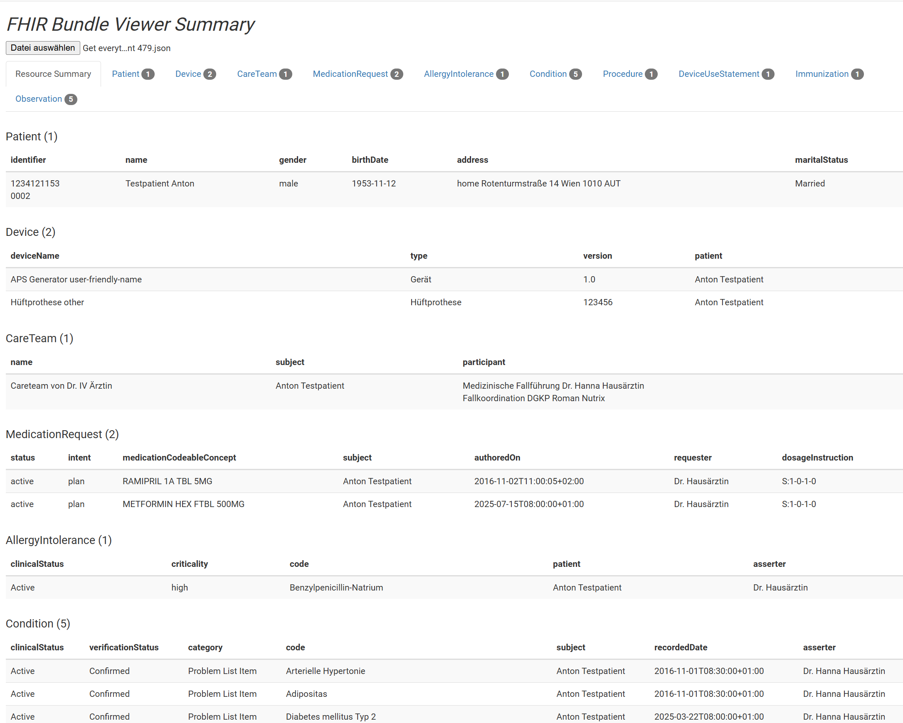

# FHIR Bundle Viewer

https://aka247.github.io/fhir-bundle-viewer/

Based on FHIR Bundle Viewer (Michael van der Zel, https://github.com/mvdzel/fhir-bundle-viewer): "A simple FHIR Bundle as a Table Viewer based on bootstrap. This viewer is initially created to visualize a Synthea generated patient. And $everything exports."

Examples: https://fhir.hl7.at/r4-ELGA-AustrianPatientSummary-main/index.html

---------
Serve via node.js "http-server" for getJSON to work.
> http-server

Then browse to http://localhost:8080